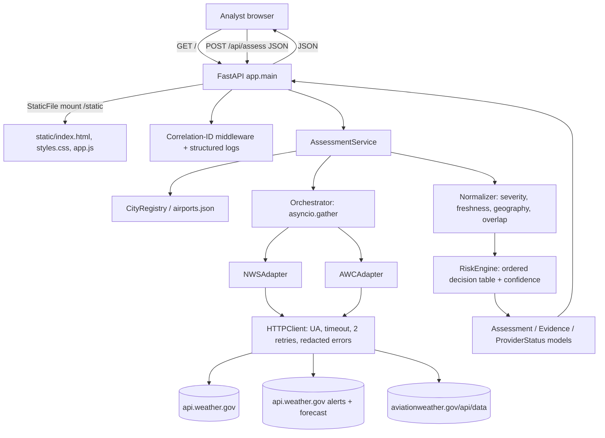
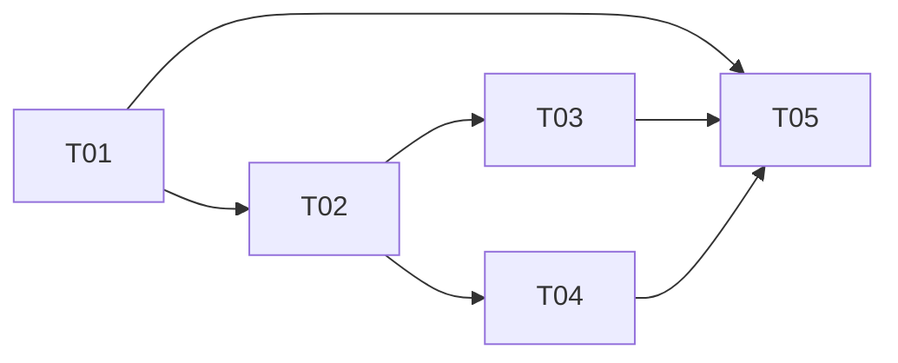

# RouteGuard — Architecture & Implementation Design

**Architect:** Gao · **Implementer:** Kou · **Access date for all live checks:** 2026-11-16 · **Language:** English.

**Source of truth:** `02_route_guard_execution_guardrails.md` (binding) and `docs/00_PRD.md`. Where they conflict, guardrails win.

**Tag convention used throughout:** `[LIVE]` = observed in this environment on 2026-11-16; `[DOC]` = stated in official documentation; `[ASSUMED]` = design decision, not provider-guaranteed; `[UNVERIFIED]` = could not be confirmed. No sample response in this document is presented as observed unless tagged `[LIVE]`; verbatim excerpts are in `docs/02_api_verification_notes.md`.

---

## 1. Scope decisions (fixed before implementation)

| Decision | Value | Basis |
|---|---|---|
| Product scope | US commercial air travel; city-pair = **airport-level** assessment, not itinerary | Guardrails §1 |
| Runtime | One FastAPI process via `uvicorn`; serves API + static frontend | Guardrails §2/§4; PRD FR-02/FR-09 |
| Providers integrated | **NWS** (alerts + gridpoint forecast) and **NOAA AWC** (METAR + TAF). Two independent providers. | `[LIVE]` both reachable; PRD FR-03 |
| AWC advisories | G-AIRMET endpoint verified available but **not integrated in MVP** | `[LIVE]` 200 with 45 records; `bbox` filter ignored; polygon point-in-polygon would be extra scope |
| FAA operational status | **NOT integrated.** UI links out only | `[LIVE]` legacy XML is reachable but `[UNVERIFIED]` as a documented/supported API; no official API docs found; guardrails forbid fragile scrapers |
| BTS history | Excluded | Guardrails §2 permits only as labelled context; adds no real-time value |
| Risk output | Ordered classes `CLEAR / LOW / ELEVATED / HIGH / CRITICAL / INDETERMINATE`; **no 0–100 score** | Guardrails §3; PRD FR-05/FR-11 |
| Time | Departure-airport local calendar date → UTC window; whole-day precision; no departure time | Guardrails §1; reduced precision disclosed in UI |

---

## 2. Verified API integration table

All calls are server-side only. `Accept: application/geo+json` for NWS; `format=json` query parameter for AWC. Every request carries `User-Agent: RouteGuardPrototype/0.1 (contact: <address>)`.

### 2.1 NWS — api.weather.gov

| Endpoint | Method / URL template | Auth & headers | Response shape (real field names) | Limits / caveats | Evidence |
|---|---|---|---|---|---|
| Point metadata | `GET https://api.weather.gov/points/{latitude},{longitude}` | No key. `[DOC]` `User-Agent` identifying app + contact; `[DOC]` ≤4 decimal places; `[LIVE]` `Accept: application/geo+json` | `[LIVE]` 200. Top: `@context`, `id`, `type`, `geometry.coordinates`, `properties`. `properties`: `cwa`, `type`, `forecastOffice`, `gridId`, `gridX`, `gridY`, `forecast`, `forecastHourly`, `forecastGridData`, `observationStations`, `relativeLocation.properties.city/state`, `forecastZone`, `county` | `[DOC]` rate limit exists but is not published; retry after ~5 s. `[LIVE]` `cache-control: public, max-age=72034, s-maxage=86400`; `x-request-id`, `x-correlation-id` returned. `[DOC]` point mapping is cacheable | `[DOC]` weather.gov/documentation/services-web-api; weather-gov.github.io/api/general-faqs; `https://api.weather.gov/openapi.json`. `[LIVE]` 200 with identifying UA at 37.6213,-122.3790; also 200 with plain `curl/8.0` (identification is documented policy, not currently enforced for this call) |
| Active alerts by point | `GET https://api.weather.gov/alerts/active?point={latitude},{longitude}` | Same as above | `[LIVE]` 200 `FeatureCollection`: `type`, `features[]`, `title`, `updated`. Each `features[i]`: `id`, `type`, `geometry` (**can be `null`**), `properties`. `properties` keys observed: `id`, `areaDesc`, `geocode` (`SAME`, `UGC`), `affectedZones`, `references`, `sent`, `effective`, `onset`, `expires`, `ends`, `status`, `messageType`, `category`, `severity`, `certainty`, `urgency`, `event`, `senderName`, `headline`, `description`, `instruction`, `response`, `parameters`, `web`, `eventCode` | `[DOC]` OpenAPI `AlertPoint`: `point` **incompatible with** `area`, `region`, `region_type`, `zone`. `[DOC]` severity enum: extreme/severe/moderate/minor/unknown. `[LIVE]` `cache-control: max-age=5`; empty point returns `features: []` with 200 — **empty is not an error** | `[DOC]` `https://api.weather.gov/openapi.json` (`/alerts/active`, `components.parameters.AlertPoint`). `[LIVE]` 200 empty at SFO point; 200 with 1 feature (`High Surf Advisory`, `severity: Minor`) at 34.23,-119.20 |
| Gridpoint forecast | `GET {properties.forecast}` from points response, template `https://api.weather.gov/gridpoints/{wfo}/{gridX},{gridY}/forecast` | Same as above | `[LIVE]` 200 Feature. `properties`: `units`, `forecastGenerator`, `generatedAt`, `updateTime`, `validTimes`, `elevation`, `periods[]`. Period keys: `number`, `name`, `startTime`, `endTime`, `isDaytime`, `temperature`, `temperatureUnit`, `probabilityOfPrecipitation.unitCode/value`, `windSpeed`, `windDirection`, `shortForecast`, `detailedForecast`, `icon` | `[LIVE]` `validTimes: "2026-11-15T22:00:00+00:00/P7DT3H"` ≈ 7-day horizon; **cannot attest dates beyond forecast horizon**. `[LIVE]` `cache-control: max-age=2463`. `[DOC]` point→grid is 2-step by design; do not use cache-busting query params (400) | `[DOC]` weather.gov docs + weather-gov.github.io FAQ. `[LIVE]` `https://api.weather.gov/gridpoints/MTR/85,98/forecast` 200 |

**Adapter consequence (NWS):** flow is `points` → then **two concurrent** calls (`alerts/active?point=`, `properties.forecast`). If `points` fails, both NWS signals are unavailable (one ProviderStatus entry, not three). Never synthesise a forecast URL from a hardcoded grid; always read it from `points`.

### 2.2 NOAA Aviation Weather Center — aviationweather.gov/data/api

| Endpoint | Method / URL template | Auth & headers | Response shape (real field names) | Limits / caveats | Evidence |
|---|---|---|---|---|---|
| METAR | `GET https://aviationweather.gov/api/data/metar?ids={icao}&format=json&hours={n}` | No key. `[DOC]` "Set a custom user agent"; `[DOC]` 100 requests/min; `[DOC]` CORS not permitted (backend required) | `[LIVE]` 200 JSON **array**. Item keys: `icaoId`, `receiptTime`, `obsTime` (epoch s), `reportTime`, `temp`, `dewp`, `wdir`, `wspd`, `visib`, `altim`, `slp`, `qcField`, `wxString`, `maxT`, `minT`, `precip`, `metarType`, `rawOb`, `lat`, `lon`, `elev`, `name`, `cover`, `clouds[{cover,base}]`, `fltCat` | `[DOC]` station IDs or bbox required; `hours` = "hours back to search"; max 400 entries; 30-day history; 204 when no data; 429 on rate limit. `[DOC]` unrecognized query params cause 400. `[LIVE]` `hours=2` accepted; two KSFO records returned | `[DOC]` `https://aviationweather.gov/data/api/` + `https://aviationweather.gov/data/schema/openapi.yaml`. `[LIVE]` 200 at `ids=KSFO&format=json&hours=2` |
| TAF | `GET https://aviationweather.gov/api/data/taf?ids={icao}&format=json` | Same as above | `[LIVE]` 200 JSON **array**. Item keys: `icaoId`, `dbPopTime`, `bulletinTime`, `issueTime`, `validTimeFrom` (epoch s), `validTimeTo` (epoch s), `rawTAF`, `mostRecent`, `remarks`, `lat`, `lon`, `elev`, `prior`, `name`, `fcsts[]`. `fcsts[i]` keys: `timeFrom`, `timeTo`, `timeBec`, `fcstChange`, `probability`, `wdir`, `wspd`, `wgst`, `visib` (string e.g. `"6+"`), `wxString`, `clouds[{cover,base,type}]`, `icgTurb`, `temp` | `[DOC]` `ids` or bbox required; `format` enum raw/json/geojson/xml/iwxxm; optional `date`; optional `time=valid|issue`; `metar=true` includes METAR. `[LIVE]` `validTimeFrom/To` span ≈30 h — **TAF cannot attest a travel date beyond its validity**. 204 when no data | `[DOC]` AWC docs + OpenAPI. `[LIVE]` 200 at `ids=KSFO&format=json` |
| G-AIRMET (advisory — **verified, not integrated**) | `GET https://aviationweather.gov/api/data/gairmet?format=json` | Same as above | `[LIVE]` 200 JSON array of 45. Item keys: `tag`, `forecastHour`, `validTime`, `hazard`, `geometryType`, `latlonpairs`, `frequency`, `severity`, `due_to`, `status`, `top`, `base`, `fzltop`, `fzlbase`, `level`, `receiptTime`, `issueTime`, `expireTime`, `product`, `geom`, `coords[{lat,lon}]` | `[DOC]` `product` ∈ sierra/tango/zulu; `hazard` ∈ turb-hi,turb-lo,llws,sfc-wind,ifr,mtn-obs,ice,fzlvl; `fore` ∈ 0/3/6/9/12. `[LIVE]` **`bbox=-123,36,-120,39` returned the same 45 records as no bbox** — server-side bbox filtering is NOT reliable; client-side geometry test required. `[LIVE]` `severity` was `null` on observed records | `[DOC]` AWC OpenAPI `/api/data/gairmet`. `[LIVE]` both calls 200 |
| CWA / SIGMET (advisory — **verified, not integrated**) | `GET https://aviationweather.gov/api/data/cwa?format=json`; `GET https://aviationweather.gov/api/data/airsigmet?format=json` | Same as above | `[DOC]` `application/json` schemas `CwaJSON`, `AirSigmetJSON`; `[LIVE]` empty body, HTTP 204 | `[DOC]` 204 = valid request, no data. Available end-to-end but no payload at access time; not relied on | `[DOC]` AWC OpenAPI; `[LIVE]` both 204 |

**Adapter consequence (AWC):** one provider adapter, two station-id calls (`metar`, `taf`) per origin and destination = up to 4 calls per assessment. Batch IDs where possible (`ids=KSFO,KJFK`) to cut calls to 2; both endpoints accept comma-separated ICAO ids `[DOC]`. Use `hours=2` for METAR. Do **not** send `hours` to TAF (not in TAF OpenAPI parameter list).

### 2.3 FAA — deliberately excluded

| Item | Finding |
|---|---|
| Official FAA "Flight Information" page `[DOC]` | Lists only human-facing links: `https://www.fly.faa.gov/flyfaa/usmap.jsp` (Airport Status & Delays), `https://www.fly.faa.gov/ois/` (NAS Status). **No developer API, no JSON feed, no API documentation, no terms-of-use page for programmatic access.** |
| Legacy endpoint `[LIVE]` | `GET https://nasstatus.faa.gov/api/airport-status-information` returned **200, `Content-Type: application/xml`, 1532 bytes**, root `<AIRPORT_STATUS_INFORMATION>` with `Update_Time`, `Dtd_File`, `Delay_type/Name`, `Ground_Delay_List/Ground_Delay/{ARPT,Reason,Avg,Max}`, `Airport_Closure_List/Airport/{ARPT,Reason,Start,Reopen}`. Verbatim excerpt in verification notes. |
| Decision | **Exclude.** The endpoint is undocumented by FAA's published information pages, is XML rather than the documented JSON APIs we standardise on, has no published stability/SLA/terms, and its data mixes airport closures (including long-term general-aviation closures) with operational delay programs. Treating it as a supported integration would breach "only where reliable programmatic access is available". No scraping of the HTML map is proposed. |
| UI behaviour | Show `FAA operational status: not integrated — check authoritative source` with links to `https://nasstatus.faa.gov/` and `https://www.fly.faa.gov/flyfaa/usmap.jsp`. This link is presented as an out-of-app verification step, never as evidence. |

---

## 3. Component diagram



---

## 4. Complete file list (relative to `routeguard/`)

| Path | One-line purpose |
|---|---|
| `README.md` | Run/test commands, scope assumptions, provider list, FAA exclusion note, ZIP manifest. |
| `requirements.txt` | Pinned well-known dependencies only (see §13). |
| `app/__init__.py` | Package marker. |
| `app/main.py` | FastAPI app, `POST /api/assess`, `GET /api/health`, static mount, validation error mapping. |
| `app/config.py` | Settings: user agent string, timeouts, retry count, freshness thresholds, external URLs, correction links. |
| `app/models.py` | Pydantic v2 models: `AssessRequest`, `Evidence`, `Assessment`, `ProviderStatus`, `Recommendation`, `RuleHit`, error envelope. |
| `app/airports.json` | Curated static set of ~48 major US airports: `city`, `state`, `iata`, `icao`, `lat`, `lon`, `nws_point`, `timezone`. |
| `app/cities.py` | Case-insensitive city/IATA lookup over `airports.json`; deterministic `LookupError` for unmapped input. |
| `app/http_client.py` | `httpx.AsyncClient` wrapper: identifying UA, 10 s timeout, ≤2 retries on 429/5xx, latency logging, redacted error text. |
| `app/providers/__init__.py` | Package marker / adapter protocol export. |
| `app/providers/base.py` | `ProviderAdapter` protocol: `name`, `fetch(...) -> list[dict], ProviderStatus`. |
| `app/providers/nws.py` | NWS points → alerts + forecast fetch; raw payload validation. |
| `app/providers/awc.py` | AWC METAR + TAF fetch for origin/destination ICAO ids. |
| `app/normalize.py` | Convert verified provider fields into `Evidence`; compute severity, reliability, geography, temporal overlap, freshness. |
| `app/risk.py` | Deterministic decision table, eligibility filters, corroboration count, confidence caps, rule-derived recommendations. |
| `app/service.py` | Orchestration: resolve airports, concurrent provider calls, normalize, assess, build `Assessment`; never raises provider errors to client. |
| `app/logging.py` | Request correlation ID, structured JSON log lines (route, date, provider, status, latency, evidence counts). |
| `static/index.html` | Dependency-free form + results/evidence/provider-status sections. |
| `static/styles.css` | Plain CSS layout; no frameworks, maps, or animations. |
| `static/app.js` | Fetch `/api/assess`, render classification, confidence, evidence table, recommendations, partial failures, assumptions. |
| `tests/__init__.py` | Test package marker. |
| `tests/conftest.py` | Fixtures loading recorded JSON from `tests/fixtures/`; `httpx.MockTransport` – no live calls. |
| `tests/fixtures/nws_points.json` | Recorded points response (SFO). |
| `tests/fixtures/nws_alerts.json` | Recorded active-alerts response (one real California alert). |
| `tests/fixtures/nws_forecast.json` | Recorded gridpoint forecast response. |
| `tests/fixtures/awc_metar.json` | Recorded METAR array (KSFO). |
| `tests/fixtures/awc_taf.json` | Recorded TAF array (KSFO). |
| `tests/test_cities.py` | City/IATA lookup, case handling, unmapped input. |
| `tests/test_normalize.py` | Severity/reliability/overlap/freshness from recorded payloads. |
| `tests/test_adapters.py` | Adapters against `MockTransport`; 200/204/429/500 and malformed JSON paths. |
| `tests/test_risk.py` | §10 scenario table plus rule-precedence and confidence-cap tests. |
| `docs/00_PRD.md` | Accepted PRD (existing). |
| `docs/01_architecture.md` | This document. |
| `docs/02_api_verification_notes.md` | Verbatim verification log with access date and status codes. |

**Airport registry rules:** `nws_point` is `"{lat},{lon}"` at ≤4 decimals `[DOC NWS precision]`; `icao` is the AWC `ids` value; no entry may be added without a real IATA/ICAO pair and real coordinates. `timezone` is an IANA name (e.g. `America/Los_Angeles`) used with stdlib `zoneinfo` — no dependency, no geocoding.

---

## 5. Data models (Pydantic v2 field lists)

```text
AssessRequest
  origin: str                 # city name or IATA, 2-64 chars
  destination: str
  date: date                  # ISO YYYY-MM-DD; departure-airport LOCAL calendar date
  departure_time: str | None  # accepted but MVP treats as absent; disclose if supplied

Evidence
  id: str                     # sha256(provider|signal_type|source_url|signal|valid_from)[:16]
  provider: Literal["NWS","AWC"]
  signal_type: Literal["NWS_ALERT","NWS_FORECAST_PERIOD","AWC_METAR","AWC_TAF"]
  signal: str                 # event / shortForecast / fltCat+wxString / wxString
  severity: Literal["EXTREME","SEVERE","MODERATE","MINOR","UNKNOWN"]
  reliability: Literal["HIGH","MEDIUM","LOW"]
  geography: Literal["EXACT","NEAR","UNKNOWN"]
  temporal_overlap: Literal["FULL","PARTIAL","NONE","UNKNOWN"]
  freshness: Literal["FRESH","STALE","UNKNOWN"]
  observed_at: datetime | None      # UTC, provider issue/observation time
  valid_from: datetime | None       # UTC
  valid_to: datetime | None         # UTC
  relevance_reason: str
  source_url: str
  raw_excerpt: str            # <=240 chars, no personal data

ProviderStatus
  provider: Literal["NWS","AWC"]
  status: Literal["OK","DEGRADED","FAILED"]
  http_status: int | None
  latency_ms: int | None
  fetched_at: datetime | None
  evidence_count: int
  error: str | None           # redacted: class + code only
  note: str                   # e.g. "204 No Content - no current METAR"
  authoritative_url: str      # human-checkable fallback

RuleHit
  rule_id: str
  description: str
  evidence_ids: list[str]

Recommendation
  priority: Literal["IMMEDIATE","HIGH","ROUTINE"]
  action: str
  rationale: str
  rule_id: str
  evidence_ids: list[str]

Assessment
  request_id: str             # correlation ID
  generated_at: datetime      # UTC
  route: dict[str,str]        # resolved origin/destination names + IATA/ICAO
  travel_date: date
  travel_window_utc: dict[str,datetime]
  classification: Literal["CLEAR","LOW","ELEVATED","HIGH","CRITICAL","INDETERMINATE"]
  confidence: Literal["HIGH","MEDIUM","LOW"]
  degraded: bool
  assumptions: list[str]      # always includes air-travel scope + whole-day precision
  triggered_rules: list[RuleHit]
  evidence: list[Evidence]
  recommendations: list[Recommendation]
  provider_status: list[ProviderStatus]
  coverage_note: str          # forward-horizon disclosure

ErrorEnvelope (all non-2xx)
  code: str                   # e.g. INVALID_ROUTE, INVALID_DATE, UNMAPPED_CITY
  message: str
  request_id: str
  details: dict | None
```

**Invariants enforced in `Assessment` model validator:** `risk` and `confidence` are independent fields (no derived numeric score); every non-`CLEAR` classification has ≥1 recommendation; every recommendation references ≥1 `evidence.id` that exists in `evidence` unless its `rule_id` is one of the terminal no-coverage rules `R01_NO_COVERAGE` or `R08_INDETERMINATE` (then `evidence_ids` may be empty); `degraded == any(p.status != "OK" for p in provider_status)`.

---

## 6. Call sequence

```mermaid
sequenceDiagram
    participant U as Browser
    participant M as FastAPI main
    participant S as AssessmentService
    participant C as CityRegistry
    participant N as NWSAdapter
    participant A as AWCAdapter
    participant H as HTTPClient
    participant Z as Normalizer
    participant R as RiskEngine

    U->>M: POST /api/assess {origin,destination,date}
    M->>M: validate date + strings; assign request_id
    M->>S: assess(request)
    S->>C: resolve(origin), resolve(destination)
    C-->>S: Airport(iata,icao,lat,lon,nws_point,timezone) or LookupError
    S->>S: build travel_window_utc from departure local date
    par NWS
        S->>N: fetch(airports)
        N->>H: GET /points/{lat,lon}
        H-->>N: points JSON (or ProviderStatus FAILED)
        N->>H: GET /alerts/active?point=
        N->>H: GET {properties.forecast}
        H-->>N: alerts JSON / forecast JSON / 204 / error
        N-->>S: raw payloads + ProviderStatus(NWS)
    and AWC
        S->>A: fetch(origin_icao, dest_icao)
        A->>H: GET /metar?ids=..&format=json&hours=2
        A->>H: GET /taf?ids=..&format=json
        H-->>A: arrays / 204 / error
        A-->>S: raw payloads + ProviderStatus(AWC)
    end
    S->>Z: normalize(payloads, travel_window_utc)
    Z-->>S: Evidence[] (invalid/stale records flagged, not dropped silently)
    S->>R: classify(Evidence[], ProviderStatus[])
    R->>R: apply R00..R07 in order; compute confidence C01..C05; build recommendations
    R-->>S: classification, confidence, RuleHit[], Recommendation[]
    S-->>M: Assessment
    M-->>U: 200 Assessment JSON (or 422 ErrorEnvelope)
```

---

## 7. Normalization rules (deterministic; `[ASSUMED]` design choices unless tagged)

### 7.1 Severity derivation — take the **highest** rule that fires for a record

| Source | Condition (real fields) | Severity |
|---|---|---|
| NWS alert | `properties.severity` = `Extreme` / `Severe` / `Moderate` / `Minor` / `Unknown` | same uppercase enum `[DOC enum, LIVE values]` |
| NWS forecast period | `max(windSpeed numbers)` ≥ 35 mph | MODERATE |
| NWS forecast period | `probabilityOfPrecipitation.value` ≥ 80 and `shortForecast` contains rain/snow/thunder (case-insensitive) | MODERATE |
| NWS forecast period | wind ≥ 20 mph, or precip ≥ 50 with precip keyword | MINOR |
| NWS forecast period | otherwise | UNKNOWN (do not emit evidence) |
| AWC METAR | `fltCat == "LIFR"` or numeric `visib < 1` | SEVERE |
| AWC METAR | `fltCat == "IFR"`, `visib < 3`, `wgst >= 50`, `wspd >= 35`, or `wxString` contains `TS` | MODERATE |
| AWC METAR | `fltCat == "MVFR"`, or non-empty `wxString` with no higher rule | MINOR |
| AWC TAF (per `fcsts[]` overlapping travel window) | numeric `visib < 1` | SEVERE |
| AWC TAF | `visib < 3`, `wxString` contains `TS`, `wgst >= 50`, `wspd >= 35` | MODERATE |
| AWC TAF | `visib < 5` | MINOR |
| AWC TAF | `visib` = `"6+"`/`"P6SM"` and no other rule | UNKNOWN (do not emit evidence) |

`fltCat` values LIFR/IFR/MVFR/VFR were not all observed in the single `[LIVE]` sample (only `VFR` observed); their meaning is standard METAR terminology `[DOC general aviation knowledge, ASSUMED for mapping]`. Parse defensively: unknown string → no rule, severity UNKNOWN.

### 7.2 Other evidence attributes

| Attribute | Rule | Status |
|---|---|---|
| `reliability` | NWS_ALERT = HIGH; NWS_FORECAST = MEDIUM; AWC_METAR = HIGH (observed fact, not forecast); AWC_TAF = MEDIUM | `[ASSUMED]` |
| `geography` | NWS point alerts and gridpoint forecast = EXACT; AWC station id matching origin/destination ICAO = EXACT; any future advisory polygon = NEAR; otherwise UNKNOWN | `[ASSUMED]`; point/station basis is `[LIVE]/[DOC]` |
| `valid_from/valid_to` | NWS alert: `onset` or `effective` → `expires` or `ends`. NWS forecast period: `startTime`→`endTime`. METAR: `reportTime`→`+1 h` (point observation). TAF: `fcsts[i].timeFrom`→`timeTo` (epoch seconds) | `[ASSUMED]` for METAR +1 h; others from `[LIVE]` fields |
| `temporal_overlap` | FULL if evidence window contains the whole travel UTC window; PARTIAL if it intersects; NONE if disjoint; UNKNOWN if no valid time. Travel window = `[00:00, 24:00)` in **origin** local date converted to UTC; destination evidence uses the same UTC window | `[ASSUMED]`, mandated by guardrails §1 |
| `freshness` | FRESH if `now - issued_at` ≤ threshold: NWS alert `sent` 24 h; NWS forecast `generatedAt` 12 h; METAR `reportTime` 3 h; TAF `issueTime` 6 h. Else STALE. Missing issue time → UNKNOWN | `[ASSUMED]` thresholds |
| `signal` | NWS alert `event`; NWS forecast `shortForecast`; METAR `fltCat + ":" + (wxString or "none")`; TAF joined distinct `wxString` values (or `"no-significant-wx"`) | `[ASSUMED]` |
| `relevance_reason` | Human sentence built from provider + geography + overlap + window, e.g. `"NWS alert covers the origin airport point and overlaps the selected travel day (PARTIAL)."` | `[ASSUMED]` |
| `source_url` | Exact request URL used, including query string | `[LIVE]` templates |
| Invalid payload | Missing required keys, wrong JSON type, or unparsable timestamp → record flagged STALE/UNKNOWN attributes and increment provider `DEGRADED`; never crash and never silently drop without a `note` | `[ASSUMED]` |

---

## 8. Risk decision table — exact rule order and precedence

### 8.1 Pre-computation (same for every run)

```text
W = travel_window_utc
eligible_core(e) = e.severity != UNKNOWN
                   AND e.geography in {EXACT, NEAR}
                   AND e.temporal_overlap in {FULL, PARTIAL}
trustworthy(e)   = eligible_core(e) AND e.reliability in {HIGH, MEDIUM} AND e.freshness == FRESH
downgraded(e)    = eligible_core(e) AND (e.freshness == STALE OR e.reliability == LOW)
eligible(e)      = eligible_core(e)     # R01 tests relevance first; trust is applied downstream
corroboration    = count(distinct provider p where exists trustworthy(e) with e.provider==p and e.severity >= MODERATE)
```

Evidence with `geography == UNKNOWN` or `temporal_overlap in {NONE, UNKNOWN}` is **excluded from all classification rules** but still displayed in the evidence table with its relevance reason. This is how "missing/unlocatable information never forces LOW".

`eligible(e)` is deliberately **the geography/overlap/time core, not `trustworthy(e)`**. R01 ("no coverage") fires only when nothing is even relevant to the travel day (core empty) or both providers failed. A signal that is relevant but stale or low-reliability stays in the core as `downgraded`, so it can reach R02/R05 (scenario S11) and be **capped** at ELEVATED instead of being discarded as "no coverage". This is the reading that satisfies both binding guardrails (§3): absent information yields `INDETERMINATE`, never LOW; unverified extreme information yields at most ELEVATED, never CRITICAL.

> **Architect reconciliation R-1 (2026-11-16) — F-02.** `eligible(e)` was previously written as `trustworthy(e)`, so §8.2 R01 implied that a stale-but-relevant item produced "no coverage". That contradicted the shipped `classify()` (`if not core or both_failed`) and §10 S11, which expects `ELEVATED` / `R02,R05` / MEDIUM for `NWS:EXTREME:HIGH:EXACT:FULL:STALE`. I have changed `eligible(e)` to `eligible_core(e)` and restated the R01 row accordingly; no application code or tests were changed. The same reconciliation resolves the F-02 C01 discrepancy recorded in QA: §8.3 C01 now carries the "at least one HIGH-reliability trustworthy item" condition already implemented in `risk.py` and required by §10 S06 (two MEDIUM-reliability corroborators cap confidence at MEDIUM). — **Gao (Architect), 2026-11-16**

### 8.2 Rules — evaluated top to bottom; **first matching terminal rule wins**; all matched rule IDs are returned

| Order | Rule ID | Condition | Classification | Notes / precedence |
|---|---|---|---|---|
| 0 | `R00_INPUT_INVALID` | Request fails Pydantic validation or city lookup | **422 error, no Assessment** | Normalize handled in `main.py`, not risk engine |
| 1 | `R01_NO_COVERAGE` | `eligible` (= `eligible_core`) set is empty **OR** both providers `FAILED` | `INDETERMINATE` | Terminal. Trust is not tested here: relevant-but-downgraded evidence stays in the core and reaches R02/R05 (S11). Explicitly prevents "no alerts ⇒ LOW". See R-1. |
| 2 | `R02_UNVERIFIED_GUARD` | Any `downgraded` evidence with severity `EXTREME` exists | *(non-terminal marker)* | Records `R02` hit; **forbids** `CRITICAL` from this evidence; it can reach at most `ELEVATED` via R05 |
| 3 | `R03_CRITICAL` | Exists trustworthy `EXTREME` **AND** `corroboration >= 2` (both NWS and AWC at ≥MODERATE) | `CRITICAL` | Only rule that can produce CRITICAL; unverified extreme never qualifies |
| 4 | `R04_HIGH` | Exists trustworthy `EXTREME` (corroboration < 2), **OR** trustworthy `SEVERE` with (`corroboration >= 2` **OR** any trustworthy `SEVERE` with `reliability == HIGH`) | `HIGH` | A single official severe alert is sufficient for HIGH but not CRITICAL |
| 5 | `R05_ELEVATED` | Exists trustworthy `MODERATE` with (`corroboration >= 2` **OR** `reliability == HIGH`), **OR** exists `downgraded` evidence with severity ≥ `MODERATE` (incl. R02 cases) | `ELEVATED` | Stale/unverified high-severity evidence lands here, never HIGH/CRITICAL |
| 6 | `R06_LOW` | Exists trustworthy `MODERATE` with `reliability == MEDIUM` and `corroboration < 2`, **OR** (`downgraded` MODERATE), **OR** trustworthy `MINOR` with `corroboration >= 2` | `LOW` | Never reached when coverage is absent (R01 is earlier) |
| 7 | `R07_CLEAR` | Both providers `OK`, ≥1 trustworthy evidence from **each** provider, and max trustworthy severity ≤ `MINOR` | `CLEAR` | Affirmative clean coverage required; partial failure cannot yield CLEAR |
| 8 | `R08_INDETERMINATE` | Any other state (incl. only one provider OK with minor evidence, all evidence out of window/horizon) | `INDETERMINATE` | Terminal fallback |

**Precedence summary:** `R01` > `R03` > `R04` > `R05` > `R06` > `R07` > `R08`; `R02` is a marker consumed by `R05` and never raises a class itself.

### 8.3 Confidence — computed **after** classification, independent axis

| Order | Rule ID | Condition | Confidence |
|---|---|---|---|
| C1 | `C01_HIGH` | Both providers OK, ≥2 trustworthy evidence, at least one per provider, travel date ≤ 48 h from generation, **and ≥1 trustworthy item with `reliability == HIGH`** | HIGH |
| C2 | `C02_MEDIUM_SINGLE` | Both providers OK but only one contributes trustworthy evidence, **or** travel date > 48 h (forecast-only horizon) | MEDIUM |
| C3 | `C03_MEDIUM_PARTIAL` | Exactly one provider DEGRADED/FAILED and the other has ≥1 trustworthy evidence | MEDIUM (**cap**); `degraded=true` |
| C4 | `C04_LOW` | Both providers FAILED, **or** the `eligible_core` is empty (no geography/overlap/time-eligible evidence), **or** any `downgraded` (core) evidence has `reliability == LOW` | LOW |
| C5 | `C05_CAP_STALE` | Any classified evidence is STALE | cap at MEDIUM (apply after C1–C4; lowest wins) |

**Partial-failure policy:** a failed provider never suppresses a class that is already supported by trustworthy evidence (e.g. S02 stays HIGH), but caps confidence at MEDIUM and sets `degraded=true`. If the surviving provider has no trustworthy evidence, R01/R08 yields `INDETERMINATE` with LOW confidence. UI shows the failed provider, its status, redacted error, and the authoritative link from `ProviderStatus.authoritative_url`.

**Confidence-boundary note for C04 (testable — R-2):** C04 keys on the **eligibility core**, not on `trustworthy`. The following states are distinct and must produce distinct confidences:

| Input state | C04 fires? | Resulting confidence | Scenario |
|---|---|---|---|
| No evidence at all, or all evidence out-of-window/unlocatable → core empty | **Yes** | `LOW` (class `INDETERMINATE` via R01) | S09 |
| Core non-empty but every item STALE (so `trustworthy` is empty while `downgraded` is not, reliability HIGH/MEDIUM) | **No** | `MEDIUM` via C05 cap (class `ELEVATED` via R02/R05) | S11 |
| Any core item with `reliability == LOW`, even when other trustworthy items exist | **Yes** | `LOW` (class capped by R02/R05, never HIGH/CRITICAL) | S12 |
| Both providers `FAILED` | **Yes** | `LOW` | — (direct C04 guard) |

The critical assertion is that **"no trustworthy evidence" by itself is not a C04 trigger**: a stale-only eligible core must land at MEDIUM, not LOW. "Missing information must not automatically produce LOW risk" (guardrail §3) constrains the **classification** axis (R01 → `INDETERMINATE`, never LOW); it does not require confidence to be non-LOW when there is genuinely no eligible evidence.

> **Architect reconciliation R-2 (2026-11-16) — F-03.** §8.3 C04 previously read "no trustworthy evidence", which would have driven stale-only extreme evidence (S11) to LOW confidence and contradicted both §10 (S11 expects MEDIUM cap) and the shipped `classify()` (`or not core`, not `or not trustworthy`). C04 is now defined on the empty eligibility core plus the LOW-reliability downgrade condition, matching shipped behaviour. No code or tests were changed. — **Gao (Architect), 2026-11-16**

### 8.4 Recommendations (rule-derived, evidence-linked)

| Rule hit | Recommendation text (template) | Priority |
|---|---|---|
| `R03_CRITICAL` | "Do not travel if alternatives exist; rebook or defer and contact the airline. Evidence: {ids}." | IMMEDIATE |
| `R04_HIGH` | "Check rebooking options now and allow extra connection time; re-check NWS alerts and airline status before leaving. Evidence: {ids}." | IMMEDIATE |
| `R05_ELEVATED` | "Monitor the flagged signal, confirm airline status, and keep a backup plan. Evidence: {ids}." | HIGH |
| `R06_LOW` | "Routine monitoring; re-check on the day of departure. Evidence: {ids}." | ROUTINE |
| `R07_CLEAR` | "No RouteGuard action beyond normal pre-flight checks. Evidence: {ids}." | ROUTINE |
| `R01_NO_COVERAGE`, `R08_INDETERMINATE` | "No conclusive coverage for this date; check FAA NAS status (external link) and the airline, then retry closer to departure." | HIGH |
| `C03_MEDIUM_PARTIAL` (always appended) | "{provider} unavailable; verify directly at {authoritative_url}." | HIGH |
| `C05_CAP_STALE` (always appended) | "Evidence is stale; treat this assessment as indicative and refresh." | HIGH |
| Forecast-only horizon (date > 7 d) | "NWS gridpoint forecast horizon is ~7 days and TAF ~30 h; this date is beyond reliable outlook — recheck later." | ROUTINE |

---

## 9. Explainability contract

Every response returns: `classification`, `confidence`, `triggered_rules[]` (rule ID + plain-English description + `evidence_ids`), `evidence[]` (provider, signal, severity, timestamp, freshness, geographic/temporal relevance, `source_url`), `recommendations[]` (each with `rule_id` + `evidence_ids`), `provider_status[]`, `assumptions[]`, `coverage_note`. The UI must render these fields verbatim; no client-side reclassification, no generated prose, no numeric score.

---

## 10. Representative test scenarios (Kou's `tests/test_risk.py`)

Notation: `NWS:SEV:HIGH:EXACT:FULL:FRESH` = provider:severity:reliability:geography:overlap:freshness. "AWC✗" = provider FAILED. Confidence values assume a travel date within 48 h of generation unless the row says otherwise.

| # | Evidence input | Expected class | Expected rule(s) | Confidence / notes |
|---|---|---|---|---|
| S01 | `NWS:EXTREME:HIGH:EXACT:FULL:FRESH` + `AWC:MODERATE:MEDIUM:EXACT:PARTIAL:FRESH` | CRITICAL | R03 | HIGH; corroboration = 2 |
| S02 | `NWS:EXTREME:HIGH:EXACT:FULL:FRESH`; AWC✗ | HIGH | R04 | MEDIUM cap, `degraded=true` (partial failure) |
| S03 | `NWS:SEVERE:HIGH:EXACT:FULL:FRESH` + `AWC:SEVERE:HIGH:EXACT:PARTIAL:FRESH` | HIGH | R04 | HIGH; corroboration = 2 but no EXTREME |
| S04 | `NWS:SEVERE:HIGH:EXACT:FULL:FRESH` only, both providers OK | HIGH | R04 | MEDIUM (single provider eligible) |
| S05 | `NWS:MODERATE:HIGH:EXACT:FULL:FRESH` only | ELEVATED | R05 | MEDIUM |
| S06 | `NWS:MODERATE:MEDIUM:EXACT:PARTIAL:FRESH` + `AWC:MODERATE:MEDIUM:EXACT:PARTIAL:FRESH` | ELEVATED | R05 | MEDIUM; corroboration = 2 |
| S07 | `AWC:MODERATE:MEDIUM:EXACT:PARTIAL:FRESH` only, both providers OK | LOW | R06 | MEDIUM |
| S08 | `NWS:MINOR:HIGH:EXACT:FULL:FRESH` + `AWC:MINOR:HIGH:EXACT:PARTIAL:FRESH`, both OK | CLEAR | R07 | HIGH; affirmative clean coverage |
| S09 | Both providers OK, NWS `features: []`, AWC 204 → no evidence | INDETERMINATE | R01 | LOW; **missing ≠ LOW** |
| S10 | `NWS:MINOR:HIGH:EXACT:FULL:FRESH`; AWC✗ | INDETERMINATE | R08 | MEDIUM cap; partial failure cannot yield CLEAR |
| S11 | `NWS:EXTREME:HIGH:EXACT:FULL:STALE` only | ELEVATED | R02, R05 | MEDIUM cap; **unverified ≠ CRITICAL** |
| S12 | `NWS:EXTREME:LOW:EXACT:FULL:FRESH` + `AWC:MODERATE:MEDIUM:EXACT:PARTIAL:FRESH` | ELEVATED | R02, R05 | LOW (C04: downgraded LOW-reliability evidence); low-reliability extreme cannot drive HIGH/CRITICAL |

Additional required assertions: same evidence input twice → byte-identical `classification/confidence/rule_ids` (determinism); no response contains fields `score`, `risk_score`, `probability`; every non-CLEAR case has ≥1 recommendation whose `evidence_ids` ⊆ emitted evidence IDs (except R01/R08); R01 test asserts no recommendation implies "low risk".

---

## 11. Shared conventions

| Concern | Convention |
|---|---|
| Naming | snake_case in Python/JSON; `PROVIDER_SIGNAL` uppercase for `signal_type`; rule IDs `Rnn_...`, confidence IDs `Cnn_...`; evidence IDs 16-char lowercase hex |
| API style | `POST /api/assess` accepts and returns `application/json`; `GET /api/health` returns `{"status":"ok"}`; UTC timestamps ISO 8601 with `Z`; dates `YYYY-MM-DD` |
| Error shape | `{"code","message","request_id","details"}`; HTTP 422 for validation/unmapped city, 502 for all providers failed is **not** used — a 200 Assessment with `INDETERMINATE` is returned so UI can show provider status |
| HTTP client | identifying `User-Agent` on 100 % of outbound calls; 10 s timeout; max 2 retries on 429/5xx only with jittered backoff; 204 treated as success-with-no-data; never parse HTML |
| Logging | One JSON line per request completion: `request_id`, `route`, `date`, `provider`, `status`, `http_status`, `latency_ms`, `evidence_count`; errors log exception class + HTTP code only (no raw tokens/payloads) |
| Provider status | Always exactly two entries (NWS, AWC); `DEGRADED` for partial/malformed, `FAILED` for transport/HTTP failure or `points` failure |
| Freshness/validity | All internal datetimes timezone-aware UTC; `zoneinfo` only for local-date→UTC conversion |
| Frontend | Vanilla HTML/CSS/JS; no build step, no external CDN; escape all server strings before insertion (`textContent`, not `innerHTML`) |
| Testing | `pytest` + `httpx.MockTransport`; **zero live calls in unit tests**; recorded fixtures are sanitised copies of `[LIVE]` payloads |

---

## 12. Dependencies (pinned, well-known only)

```text
fastapi==0.115.6        # HTTP API + Pydantic validation
uvicorn==0.34.0         # single-process ASGI server, serves API and static files
httpx==0.28.1           # async backend HTTP client with MockTransport for tests
pydantic==2.10.4        # explicit pin; fastapi dependency, used directly for models
pytest==8.3.4           # unit tests
```

Python 3.11+ (`zoneinfo`, `datetime`, `hashlib`, `json`, `asyncio`, `uuid` from stdlib). No additional front-end packages, no geocoding/dateutil/parsing libraries.

**Verification against `requirements.txt` (2026-11-16):** the package set and minimum versions match exactly, but the `==` notation above overstates precision. `requirements.txt` actually declares `fastapi>=0.115.6,<1`, `uvicorn>=0.34.0,<1`, `httpx>=0.28.1,<1`, `pydantic>=2.10.4,<3`, `pytest>=8.3.4,<10` — compatible ranges, so an installed version may be newer than the `==` values shown. Treat the table as the **tested floor**, not a hard pin; no package is missing or extra. — **Gao (Architect), 2026-11-16**

---

## 13. Limitations & out-of-scope (must appear in README and UI)

1. **Airport-level, not itinerary-level:** no flight number, gate, schedule, connection, or aircraft route is emitted; no invented airports.
2. **Whole travel day:** no departure time, so precision is reduced; the selected date is the departure airport's local calendar date. Destination evidence is evaluated against the same UTC window — arrival-local date is not modelled.
3. **Forward horizon:** `[LIVE]` NWS gridpoint forecast ≈ 7 days (`P7DT3H`) and TAF ≈ 30 h; NWS `alerts/active` only returns alerts active now. Beyond these horizons the engine returns `INDETERMINATE`, never a reassuring LOW.
4. **Weather ≠ operations:** NWS/AWC are weather signals. RouteGuard never claims an airport is delayed or closed. FAA operational status is not integrated.
5. **FAA not integrated:** see §2.3; authoritative links offered instead.
6. **AWC advisories not integrated:** G-AIRMET reachable but needs client-side polygon filtering (`bbox` ignored in live test) and out-of-scope for MVP.
7. **No numerical score**, no AI/LLM at runtime; classification is deterministic.
8. **Rate limits:** NWS publishes no numeric limit; AWC 100 req/min, ≤400 entries. A 48-airport route still issues at most 2 NWS calls + 2 AWC calls per assessment; add a simple in-process 60 s per-provider throttle if demo traffic is repeated.
9. **Caching:** MVP does not cache beyond provider HTTP `Cache-Control`; repeated demo runs are acceptable. Production would add caching, auth, monitoring and a real FAA data agreement.
10. **Timezone DST edge cases:** IANA zones via `zoneinfo` handle DST; ambiguous/nonexistent local midnight on transition days uses Python's default fold behaviour and is disclosed as reduced precision.
11. **City coverage:** ~48 curated airports only; unmapped input returns a clear `UNMAPPED_CITY` error, not a guess.

### 13.1 Benign in-horizon coverage is intentionally not reassuring (F-06)

For an ordinary future-date run (e.g. JFK→SFO, 1–2 days out) it is **expected, not a defect**, that the engine returns `INDETERMINATE` / `LOW` even though both provider calls succeeded (`provider_status = [NWS OK 200, AWC OK 200]`, `degraded=false`):

- NWS gridpoint periods that meet none of the §7.1 severity thresholds are deliberately **not emitted** (`severity == UNKNOWN` → "do not emit evidence"). The absence of a flagged hazard is not positive evidence of safe conditions.
- An AWC METAR is a ~1 h point observation (§7.2). For a travel day 1–2 days out its window has `temporal_overlap == NONE`, so it remains visible in `evidence[]` but is excluded from the eligibility core. TAF validity is ~30 h and fails the same test beyond that horizon.
- The core is therefore empty: R01 fires → `INDETERMINATE`, and C04 (empty core) → `LOW` confidence. R07 `CLEAR` requires ≥1 trustworthy evidence from **each** provider; it cannot be satisfied by reachability alone.

**"Both providers reached" is not the same as "both contributed eligible evidence."** `ProviderStatus.status == OK` asserts only that the HTTP request succeeded and the payload was readable. It makes no claim that any returned record is severe enough, geographically relevant and temporally overlapping for the selected travel day. Two `OK` statuses with zero eligible evidence is the normal shape of an inconclusive assessment — the outputs say so honestly rather than converting silence into reassurance.

Emitting benign periods as reassurance, or lowering R07 to "both providers reachable", would manufacture a LOW/CLEAR from an absence of information and breach guardrail §3 ("Missing information must not automatically produce LOW risk") and R01's "no alerts ⇒ LOW" prohibition. No normalization or R07 change is warranted in the MVP.

**How the UI and README should describe it (prescribed here; not applied to those files in this reconciliation):** phrase a healthy in-horizon run as *"both weather providers were contacted successfully; no eligible hazard evidence was found for the selected travel day, so no risk level can be concluded — re-check closer to departure"*. Never render it as "all clear", "low risk" or "two providers confirm safe conditions". Keep the two `provider_status` entries labelled as **data-gathering status**, keep `coverage_note` visible, and show the R01 recommendation verbatim. The README should list this under limitations as an intentional behaviour: a normal future-date run may remain `INDETERMINATE` by design.

— **Gao (Architect), 2026-11-16**

---

## 14. Ordered implementation task list (dependencies shown)

| Task | Name | Source files | Depends on | Priority |
|---|---|---|---|---|
| T01 | **Project infrastructure** — runnable skeleton, pinned deps, entrypoint, static shell, config, logging | `requirements.txt`, `README.md`, `app/__init__.py`, `app/main.py`, `app/config.py`, `app/logging.py`, `static/index.html`, `static/styles.css`, `static/app.js` | — | P0 |
| T02 | **Data + models + city registry** — Pydantic schemas, curated airport mapping and lookup | `app/models.py`, `app/airports.json`, `app/cities.py`, `tests/__init__.py`, `tests/conftest.py`, `tests/fixtures/*.json`, `tests/test_cities.py` | T01 | P0 |
| T03 | **Provider layer** — HTTP client and NWS/AWC adapters with recorded-response tests | `app/http_client.py`, `app/providers/__init__.py`, `app/providers/base.py`, `app/providers/nws.py`, `app/providers/awc.py`, `tests/test_adapters.py` | T02 | P0 |
| T04 | **Normalization + risk engine** — evidence derivation, decision table, confidence, recommendations, full scenario suite | `app/normalize.py`, `app/risk.py`, `tests/test_normalize.py`, `tests/test_risk.py` | T02 | P0 |
| T05 | **Orchestration + integration + QA handoff** — wire service into FastAPI, render results/partial failures, run live smoke test and ZIP manifest | `app/service.py`, `app/main.py` (wire-up), `static/app.js` (render), `README.md` (final), `docs/01_architecture.md`, `docs/02_api_verification_notes.md` | T01, T03, T04 | P0 |



**Definition of done for T05:** `uvicorn app.main:app --reload` serves the form and assessment; live run shows NWS + AWC evidence with real URLs; one simulated provider failure shows degraded status and authoritative link; `pytest -q` passes; README documents run steps, assumptions and the FAA exclusion.
